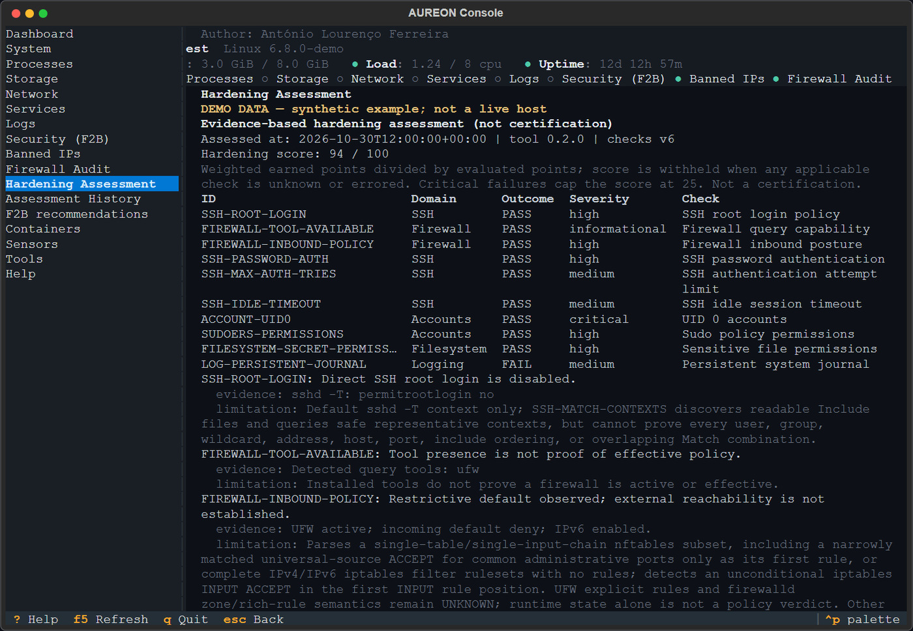

# AUREON Console
Read-only terminal console for Linux servers: system monitoring, diagnostics,
logs and **Fail2ban security insights** - all in one SSH session.
Author: **António Lourenço Ferreira** · License: **MIT** · Version: **0.1.0**
> AUREON Console never changes your server. It reads, it reports, it stores its
> own history locally, and it tells you where a number came from.
---
## What it does
| Module | Contents |
|---|---|
| Dashboard | Host, OS, kernel, uptime, CPU, load, memory, swap, health indicators |
| Processes | Top CPU/RAM consumers (never terminates anything) |
| Storage | Filesystems, usage, block devices, LVM, disk inventory |
| Network | Interfaces, addresses, traffic rates, listening sockets, established connections |
| Services | systemd units (and a SysV fallback), failed units, restart counts |
| Logs | `journalctl` with unit / priority / time / text filters, bounded |
| Security (Fail2ban) | Install & service state, jail inventory, ban history by period, IP recurrence |
| Firewall audit | Read-only UFW, nftables, iptables/ip6tables and firewalld query output with per-query availability |
| Hardening assessment | Read-only evidence-based security assessment |
| Banned IPs | Live list (root) and historical bans from AUREON's own store |
| F2B config | Assisted, reversible, opt-in configuration proposal with a diff |
| Containers | Docker/Podman state, restart loops, local images |
| Sensors | Temperatures, fans, NVIDIA GPU telemetry (only what really exists) |
| Tools | Inventory of optional third-party tools, licenses, and how AUREON uses them |
## Screenshots

Real captures of the running terminal application with anonymized host identity.

### Dashboard


### Firewall audit


### Hardening assessment

## Requirements
- Linux, Python **3.9+**, a terminal over SSH (80x24 works; wider is better).
- Read access to `/proc`, `/sys`, `/var/log`; optional root for the live
  Fail2ban ban list and `systemd`/Docker details.
- Runtime dependencies: `textual`, `rich` (both MIT). No database server, no web
  server, no network port.
## Install
```bash
git clone <repository-url> aureon-console
cd aureon-console

./install.sh                 # per-user install into ~/.local
sudo ./install.sh            # system-wide (root-owned venv, /var/lib/aureon)

export PATH="$HOME/.local/bin:$PATH"
aureon
```
Recommended for the security module:
```bash
sudo aureon
```
Uninstall (the history database is **kept** unless you ask for it):
```bash
./install.sh --uninstall
./install.sh --uninstall --purge-data    # deletes AUREON data after confirmation
```
Details: [`docs/INSTALLATION.md`](docs/INSTALLATION.md).
## Headless use
Every feature has a scripting entry point - useful over SSH without a TTY, in
cron, or in CI:
```bash
aureon doctor                       # environment and requirement check
aureon modules --json               # probe every collector, print availability
aureon stats --period today         # security statistics
aureon stats --period month --json  # machine readable
aureon ingest                       # collect events into the local store
aureon ingest --import-history      # import everything still in fail2ban.log
aureon db info | backup | integrity | vacuum | prune
aureon export --output summary.csv
aureon f2b status
aureon f2b plan                     # proposal only, nothing is written
aureon f2b plan --diff              # unified diff of the proposal
```
## What is stored on your server
| Data | Location | Notes |
|---|---|---|
| Configuration | `~/.config/aureon/config.toml` (0600) | optional |
| History database | `~/.local/share/aureon/aureon.db` or `/var/lib/aureon/aureon.db` | normalised security events only |
| Backups | `<state dir>/backups` | created only by `aureon db backup` |
| Systemd backup (wizard) | `/var/backups/aureon` | only if you explicitly apply a configuration |
**No telemetry, no outbound connections, no log uploads.** The historical store
contains event timestamps, IPs, jail names and (optionally, off by default)
usernames. See [`docs/PRIVACY.md`](docs/PRIVACY.md).
## Safety model
- **Read-only by default.** No service restarts, no firewall edits, no SSH
  config changes, no process kills, no automatic updates.
- **Every number shows its source.** "0 events" and "no data collected" are
  never conflated.
- **Writes are opt-in.** The Fail2ban wizard only writes when you pass
  `--apply --yes` *and* set `AUREON_ALLOW_F2B_WRITES=1`; it validates with
  `fail2ban-client -t`, backs up the file it replaces and targets a single
  drop-in (`jail.d/aureon-sshd.local`) that you can delete to revert.
- **Root is never assumed.** Without it, live ban lists are reported as
  unavailable instead of being guessed.
See [`docs/SECURITY.md`](docs/SECURITY.md).
## Data accuracy (read this before trusting a number)
Fail2ban does not keep a durable history of bans. AUREON therefore builds its
own store while the console runs, imports what already exists in
`fail2ban.log`, and states the exact coverage window of the data. Statistics
for a period with no coverage are labelled *unavailable*, never zero. Full
methodology: [`docs/DATA-ACCURACY.md`](docs/DATA-ACCURACY.md).
## Documentation index
| Document | Purpose |
|---|---|
| [ARCHITECTURE.md](docs/ARCHITECTURE.md) | Layers, data flow, extension points |
| [INSTALLATION.md](docs/INSTALLATION.md) | Install, update, uninstall, recovery |
| [CONFIGURATION.md](docs/CONFIGURATION.md) | Every option and environment variable |
| [COMPATIBILITY.md](docs/COMPATIBILITY.md) | Distributions, init systems, terminals |
| [SECURITY.md](docs/SECURITY.md) | Threat model, controls, residual risks |
| [PRIVACY.md](docs/PRIVACY.md) | Data collected, retention, deletion |
| [DEPENDENCIES.md](docs/DEPENDENCIES.md) | Direct/transitive deps and licenses |
| [FAIL2BAN.md](docs/FAIL2BAN.md) | The security module in depth |
| [LOGS-AND-RETENTION.md](docs/LOGS-AND-RETENTION.md) | Log sources, storage, retention |
| [DATA-ACCURACY.md](docs/DATA-ACCURACY.md) | Period definitions and guarantees |
| [TROUBLESHOOTING.md](docs/TROUBLESHOOTING.md) | Common failures and fixes |
| [VIDEO-REFERENCE.md](docs/VIDEO-REFERENCE.md) | Analysis of the reference video (not accessible) |
| [RELEASE-CHECKLIST.md](docs/RELEASE-CHECKLIST.md) | What must be true before a release |
| [CHANGELOG.md](CHANGELOG.md) | Release history |
## Contributing
Issues, bug reports and pull requests are welcome - read
[CONTRIBUTING.md](CONTRIBUTING.md) and [CODE_OF_CONDUCT.md](CODE_OF_CONDUCT.md)
first. Security issues: see [SECURITY.md](SECURITY.md).
## Status
Pre-release (`0.1.0`). The repository is prepared for **private review**. No
public release, announcement or mirror has been made.