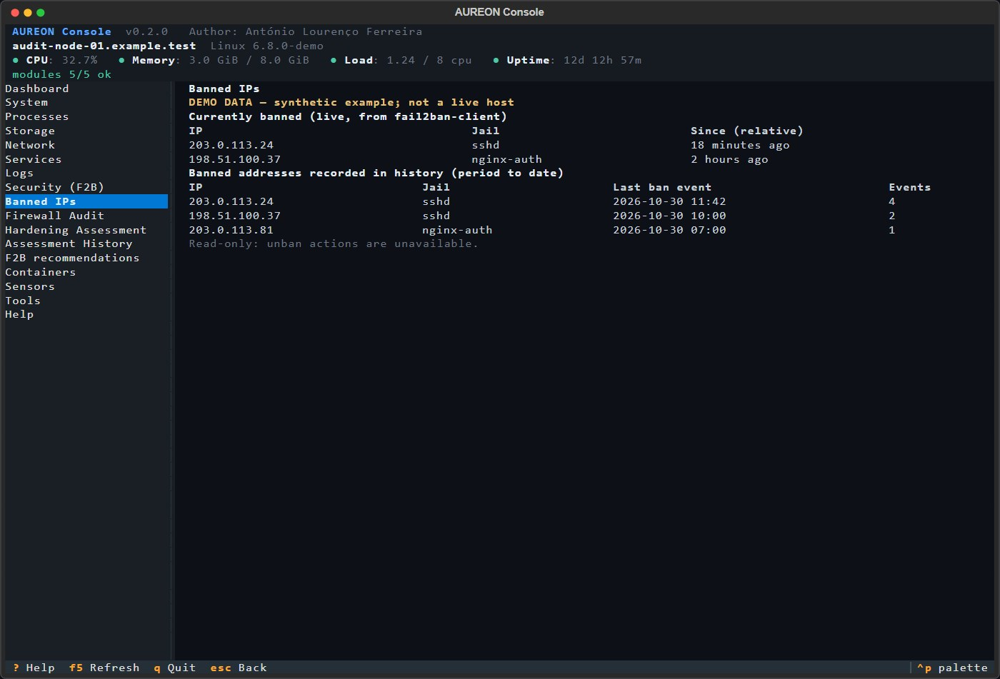
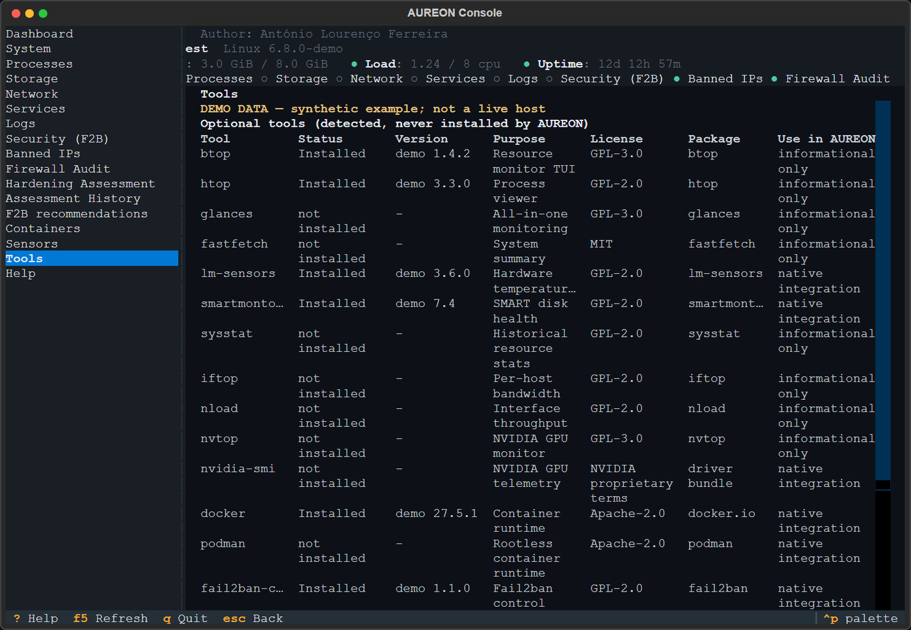

# AUREON Console

Read-only terminal console for Linux servers: system monitoring, diagnostics,
logs and **Fail2ban security insights** - all in one SSH session.

Author: **António Lourenço Ferreira** · License: **MIT** · Version: **0.2.0**

> AUREON Console never changes your server. It reads, it reports, it stores its
> own history locally, and it tells you where a number came from.

---

## What it does

| Module | Contents |
|---|---|
| Dashboard | Host, OS, kernel, uptime, CPU, load, memory, swap, health indicators |
| Processes | Top CPU/RAM consumers (never terminates anything) |
| Storage | Filesystems, usage, block devices, LVM, disk inventory |
| Network | Interfaces, addresses, traffic rates, listening sockets, established connections |
| Services | systemd units (and a SysV fallback), failed units, restart counts |
| Logs | `journalctl` with unit / priority / time / text filters, bounded |
| Security (Fail2ban) | Install & service state, jail inventory, ban history by period, IP recurrence |
| Firewall audit | Read-only UFW, nftables, iptables/ip6tables and firewalld query output with per-query availability |
| Hardening assessment | Read-only checks across SSH, accounts/sudo, filesystem metadata, mounts, journald/audit, host protections, Fail2ban, bounded Docker/Podman inspection (including stopped containers), cache-only security-update queries for APT/DNF/zypper, network listeners, kernel settings, time sync, backups and firewall; incomplete evidence remains UNKNOWN |
| Banned IPs | Live list (root) and historical bans from AUREON's own store |
| F2B recommendations | Read-only configuration proposal and diff; AUREON never applies it |
| Containers | Docker/Podman state, restart loops, local images |
| Sensors | Temperatures, fans, NVIDIA GPU telemetry (only what really exists) |
| Tools | Inventory of optional third-party tools, licenses, and how AUREON uses them |

## Supported operating systems

AUREON runs **on Linux servers only**. Its collectors read Linux `/proc` and
`/sys` interfaces; Windows, macOS and BSD are not supported as the machine
being audited. You can still use a Windows/macOS SSH terminal to connect to a
supported Linux server and run AUREON there.

| Operating system / distribution | Compatibility |
|---|---|
| Ubuntu 22.04 LTS and 24.04 LTS | CI test targets (Python 3.9, 3.11 and 3.12) |
| Debian 12, Fedora 43 and AlmaLinux 9 | Installer and CLI smoke-tested in containers by CI on every commit |
| RHEL/Rocky, Arch, openSUSE and Alpine Linux | Expected to work with Python 3.9+ and readable `/proc` and `/sys`; not covered by CI |
| Windows, macOS, FreeBSD and other non-Linux systems | Not supported for running the application |
| Linux containers | Partial support only when required host interfaces and files are visible; unavailable collectors are reported rather than inferred |

Compatibility does not mean every module is available on every Linux host:
service managers, logs, firewall utilities, Fail2ban and optional tools vary by
distribution and installation. See [the detailed compatibility notes](docs/COMPATIBILITY.md).

## Requirements

- Linux, Python **3.9+**, a terminal over SSH (80x24 works; wider is better).
- Read access to `/proc`, `/sys`, `/var/log`; optional root for the live
  Fail2ban ban list and `systemd`/Docker details.
- Runtime dependencies: `textual`, `rich` (both MIT). No database server, no web
  server, no network port.

## Quick start

Linux with Python 3.9+ is the only requirement. No root, no daemon, no open
port, no database server.

```bash
git clone https://github.com/antonioferreira2/aureon-console.git
cd aureon-console
./install.sh

export PATH="$HOME/.local/bin:$PATH"
aureon doctor    # check Python, collectors and Fail2ban availability
aureon           # open the console
```

`install.sh` creates a private virtualenv in `~/.local/share/aureon/venv`,
links `~/.local/bin/aureon` and installs no system packages. A system-wide
install is optional:

```bash
sudo ./install.sh            # root-owned venv under /usr/local, state in /var/lib/aureon
```

Run the console as your normal user. `sudo aureon` is only needed for the live
Fail2ban ban list, which reads the Fail2ban socket; everything else reports
what it can read and labels unreadable sources as unavailable instead of
guessing.

Uninstall (the history database is **kept** unless you ask for it):

```bash
./install.sh --uninstall
./install.sh --uninstall --purge-data    # deletes AUREON data after confirmation
```

Details: [`docs/INSTALLATION.md`](docs/INSTALLATION.md). Language: set `language = "pt_PT"` or `AUREON_LANGUAGE=pt_PT` for European Portuguese (`pt` is accepted as an alias). Supported values are `en`, `pt_PT`, `es`, `fr`, `it`, `zh_CN` and `ru`.

Hardening checks, limitations and assessment history: [`docs/HARDENING.md`](docs/HARDENING.md), with six translated editions linked there.

## Screenshots

Screenshots use the real terminal UI and renderers with **synthetic demo data**;
they do not show a live host or real bans, firewall rules, or tool inventory.
The reserved TEST-NET IP addresses are examples only. Click an image to open it
at full size.

### Dashboard

[](assets/screenshots/dashboard.jpg)

### Firewall audit

[](assets/screenshots/firewall.jpg)

### Hardening assessment

[](assets/screenshots/assessment.jpg)

### Banned IPs

[](assets/screenshots/banned.jpg)

### Tools

[](assets/screenshots/tools.jpg)

## Headless use

Every feature has a scripting entry point - useful over SSH without a TTY, in
cron, or in CI:

```bash
aureon doctor                       # environment and requirement check
aureon modules --json               # probe every collector, print availability
aureon stats --period today         # security statistics
aureon stats --period month --json  # machine readable
aureon ingest                       # collect events into the local store
aureon ingest --import-history      # import everything still in fail2ban.log
aureon db info | backup | integrity | vacuum | prune
aureon export --output summary.csv
aureon f2b status
aureon f2b plan                     # advisory proposal only; no host writes
aureon f2b plan --diff              # unified diff of the advisory proposal
aureon firewall --json              # local firewall evidence (if query tools are installed)
aureon assess --json                # run and save a full local hardening assessment
aureon assess --format csv --output assessment.csv
aureon assess-history --json         # list saved assessment snapshots
aureon assess-compare 1 2 --json     # compare outcomes by stable check ID
```

## What is stored on your server

| Data | Location | Notes |
|---|---|---|
| Configuration | `~/.config/aureon/config.toml` (0600) | optional |
| History database | `~/.local/share/aureon/aureon.db` or `/var/lib/aureon/aureon.db` | normalised security events only |
| Backups | `<state dir>/backups` | created only by `aureon db backup` |

**No telemetry, no outbound connections, no log uploads.** The historical store
contains event timestamps, IPs, jail names and (optionally, off by default)
usernames. See [`docs/PRIVACY.md`](docs/PRIVACY.md).

## Safety model

- **Read-only with respect to the audited host.** No service restarts, no firewall edits, no SSH
  config changes, no process kills, no automatic updates.
- **Every number shows its source.** "0 events" and "no data collected" are
  never conflated.
- **Audited-host writes are not supported.** The Fail2ban wizard can show a proposal and diff only. Legacy `--apply`, `--yes`, and write-enable configuration are accepted for compatibility but always refused; no file is written and no service is reloaded.
- **Root is never assumed.** Without it, live ban lists are reported as
  unavailable instead of being guessed.

See [`docs/SECURITY.md`](docs/SECURITY.md).

## Data accuracy (read this before trusting a number)

Fail2ban does not keep a durable history of bans. AUREON therefore builds its
own store while the console runs, imports what already exists in
`fail2ban.log`, and states the exact coverage window of the data. Statistics
for a period with no coverage are labelled *unavailable*, never zero. Full
methodology: [`docs/DATA-ACCURACY.md`](docs/DATA-ACCURACY.md).

## Documentation index

| Document | Purpose |
|---|---|
| [ARCHITECTURE.md](docs/ARCHITECTURE.md) | Layers, data flow, extension points |
| [INSTALLATION.md](docs/INSTALLATION.md) | Install, update, uninstall, recovery |
| [CONFIGURATION.md](docs/CONFIGURATION.md) | Every option and environment variable |
| [COMPATIBILITY.md](docs/COMPATIBILITY.md) | Distributions, init systems, terminals |
| [SECURITY.md](docs/SECURITY.md) | Threat model, controls, residual risks |
| [PRIVACY.md](docs/PRIVACY.md) | Data collected, retention, deletion |
| [DEPENDENCIES.md](docs/DEPENDENCIES.md) | Direct/transitive deps and licenses |
| [FAIL2BAN.md](docs/FAIL2BAN.md) | The security module in depth |
| [LOGS-AND-RETENTION.md](docs/LOGS-AND-RETENTION.md) | Log sources, storage, retention |
| [DATA-ACCURACY.md](docs/DATA-ACCURACY.md) | Period definitions and guarantees |
| [HARDENING.md](docs/HARDENING.md) | Assessment checks, scoring, local history and report exports (English) |
| [HARDENING.pt.md](docs/HARDENING.pt.md) | Avaliação de hardening (português) |
| [HARDENING.es.md](docs/HARDENING.es.md) | Evaluación de hardening (español) |
| [HARDENING.fr.md](docs/HARDENING.fr.md) | Évaluation du durcissement (français) |
| [HARDENING.it.md](docs/HARDENING.it.md) | Valutazione hardening (italiano) |
| [HARDENING.zh_CN.md](docs/HARDENING.zh_CN.md) | 加固评估（简体中文） |
| [HARDENING.ru.md](docs/HARDENING.ru.md) | Оценка защищённости (русский) |
| [TROUBLESHOOTING.md](docs/TROUBLESHOOTING.md) | Common failures and fixes |
| [RELEASE-CHECKLIST.md](docs/RELEASE-CHECKLIST.md) | What must be true before a release |
| [CHANGELOG.md](CHANGELOG.md) | Release history |

## Contributing

Issues, bug reports and pull requests are welcome - read
[CONTRIBUTING.md](CONTRIBUTING.md) and [CODE_OF_CONDUCT.md](CODE_OF_CONDUCT.md)
first. Security issues: see [SECURITY.md](SECURITY.md).

## Status and support

`0.2.0` is the current release and this repository is public. Tested and
expected platforms are listed above and detailed in
[COMPATIBILITY.md](docs/COMPATIBILITY.md); security reports follow
[SECURITY.md](SECURITY.md).

AUREON is a read-only visibility tool: it helps you see the state of a Linux
server, but it is not a certification, a SIEM, an IDS or a substitute for a
full security audit. Where evidence is missing it says so instead of assuming
the host is safe.
